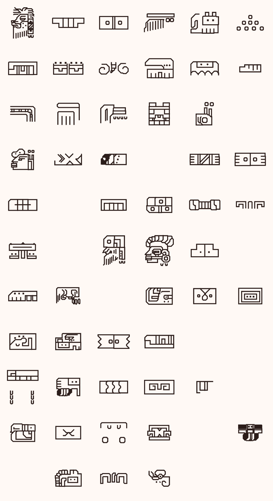

# Mati Mati · Epi-Olmec writing

Fonts and an online keyboard for the Epi-Olmec (Isthmian) script, built with the Mati Mati brand.

- **Keyboard:** type in Latin letters, see the signs in vertical columns, change colours and spacing, and download a transparent PNG (or SVG).
- **Three fonts**, all drawn from the same tracings:

| Font | Style |
| --- | --- |
| **Epi-Olmec Pal** | Linear and geometric (think Orbitron, Science Gothic): only horizontal, vertical and 45° strokes, chamfered corners, square dots. |
| **Epi-Olmec Juego** | Hand-brushed and playful (think Marhey, Potta One, Stick): a heavy stroke that swells and tapers, with a slight hand wobble and plump dots. |
| **Epi-Olmec Estela** | Thick verticals and thin horizontals with small serifs, like a Song typeface (宋体). |

Each font has the 53 known syllabic signs, 6 alternate forms, 4 closed-syllable signs (kak, pak, pük, yaj), 12 logograms and the bar-and-dot numerals 0–19 (0 is a shell, following the Mesoamerican convention; no zero survives in Epi-Olmec texts).



## How it works

Everything is Rust:

- **`crates/core`**: the syllabary inventory and the spelling rules (Latin → signs).
- **`crates/forge`**: vectorizes the signs and writes the fonts.
  1. It cuts the syllabary chart (`sources/syllabary-chart.png`) into its 11 × 6 cells.
  2. For each sign it traces the centre lines (skeleton), solid black areas, dots and small circles, then straightens near-horizontal and near-vertical lines so boxes come out crisp.
  3. It redraws those parts with each style's pen: straight and 45° lines (Pal), a tapering brush (Juego) or a flat wide pen that makes horizontals thin and verticals thick (Estela).
  4. It writes TrueType fonts with vertical metrics (each sign takes its own height in a column) and ligatures.

  Logograms (`sources/logograms/*.png`) and closed-syllable signs (`sources/cvc/*.png`) are cropped from Kaufman & Justeson (2001).
- **`crates/wasm`**: the spelling rules compiled to WebAssembly for the keyboard.
- **`crates/site`**: builds the static site into `dist/` and can serve it locally.
- **`site/`**: HTML, CSS (Mati Mati design tokens) and JavaScript.

Outputs: `fonts/*.ttf`, `site/data/glyphs.json` (the same outlines, for the keyboard) and `previews/*.png` (to check the tracing by eye).

## Typing

| You type | You get |
| --- | --- |
| `pa`, `tsi`, `ko` | one syllabic sign each |
| `a`, `e`, `i`… | the glottal-stop row: a vowel on its own is its sign. Inside a word, mark it with `'` (`poy'a`); `h`, `7` and `ʔ` also work |
| `tsa` | tsa: **ts** is one consonant (`tza` also works) |
| `kv`, `kü` | kü (ü is the central vowel /ɨ/) |
| `ja~` | the alternate form of ja (pa, tsa, kü, i, si and ja have one) |
| `[sky]`, `[cielo]` | a logogram (English or Spanish name); the keyboard shows each one's proposed reading |
| `kak`, `pük`, or `[kak]` | a closed-syllable sign (kak, pak, pük, yaj); the fonts use `[kak]` |
| `0`–`19` on the site, `#0`–`#19` in the fonts | a bar-and-dot numeral (0 = shell) |
| a new line | a new column |

With **Epi-Olmec rules** turned on (the default), the keyboard spells words the way the inscriptions do (Kaufman & Justeson §2):

- a consonant with no vowel is written with the sign that repeats the previous vowel: `tsap` → tsa·pa;
- the glottal stop, j, w and y with no vowel are not written: `poy'a` → po·a;
- k (and probably p) are not written before s.

Syllables with no known sign show as ◌: tso, ka, e, se, so, jü, mu, mo, no, wu, yi, yu, yo. Kaufman & Justeson (2001, p. 2.6) give no sign for them, and we found no other published proposal.

## Corpus

`site/data/corpus.json` lists 76 words read by Kaufman & Justeson (2001, lexical items pp. 2.91–2.97 and §1–2), with glosses in Spanish and English, their original spelling and what to type here. The site shows them with their signs and a search box. `cargo test` checks that every entry spells with known signs only.

In other apps, install a `.ttf`. Ligatures turn the Latin letters into signs. For columns, use vertical text (CSS: `writing-mode: vertical-lr; text-orientation: upright`). Every sign also has a Private Use Area code point (syllables from U+E000, closed syllables from U+E100, logograms from U+E200, numerals from U+E300). The keyboard's **Copy text (font)** button copies those.

## Run it locally

You need Rust, plus these two tools (one-time setup):

```bash
rustup target add wasm32-unknown-unknown
cargo install wasm-bindgen-cli --version 0.2.100 --locked
```

Then:

```bash
cargo run -p epi-olmec-forge --release          # fonts, glyph data, previews
cargo run -p epi-olmec-site --release -- --serve # site at http://127.0.0.1:3000/
cargo test --workspace --exclude epi-olmec-wasm
```

## Publishing

Every push to `main` rebuilds the fonts and the site and deploys them to GitHub Pages (`.github/workflows/pages.yml`).

One-time setup: Settings → Pages → Source: "GitHub Actions".

## Sources

- Terrence Kaufman and John Justeson, *Epi-Olmec Hieroglyphic Writing and Texts* (2001): the syllabary (figure 4), the spelling rules (§2) and the logograms (§1.3, §2.3). Readings are theirs and some are tentative. This project writes their 7 (ʔ) as a bare vowel at the start of a word and `'` inside it, and their tz as **ts**.
- `sources/syllabary-chart.png`: a redrawing of that syllabary chart.
